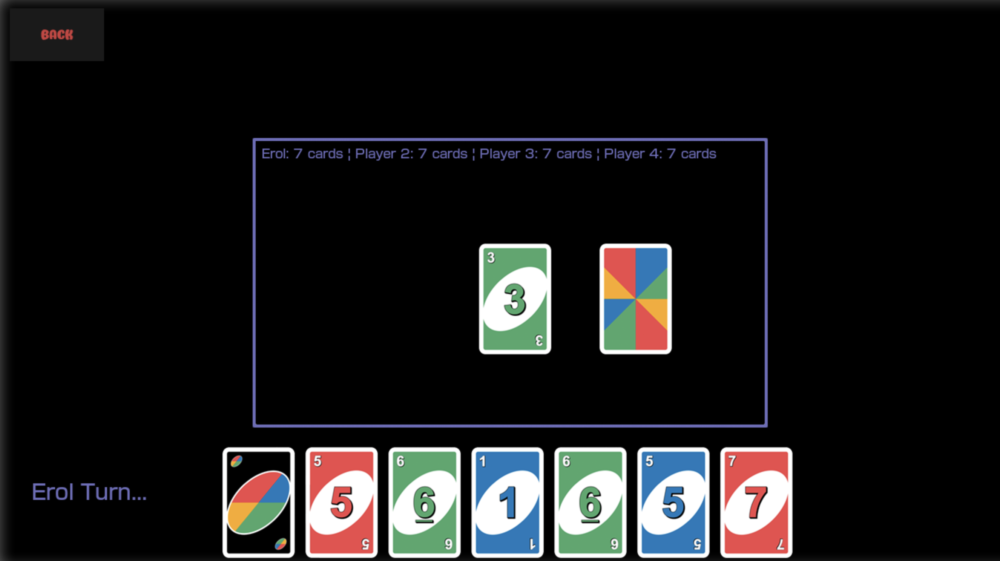

# UNO

A digital version of UNO in Python and Pygame. You play against three AI opponents whose behaviour changes during the game, and your stats are saved to SQLite and shown on leaderboards.

I built it for my AQA A Level Computer Science NEA (2023). In 2026 I came back to it and fixed bugs and security issues.



📄 **[NEA write-up](docs/NEA-Report.pdf)**: analysis, user interviews, design, algorithms, testing and evaluation (64 pages)

## Features

- **Four-player UNO** against 3 AI opponents. Play changes direction clockwise and anticlockwise, and every special card is in: reverse, block, +2, wild and wild +4.
- **Three game modes:**
  - **Normal** uses the full deck.
  - **No Wilds** leaves out the wild cards.
  - **Numbers** uses number cards only.
- **Accounts:** you sign up and sign in with a username. Stats (games, wins, losses and draws) are stored per game mode in SQLite.
- **Leaderboards** come in two views:
  - **Separate** ranks players in one mode by games, wins, losses or draws.
  - **Compare** puts two modes side by side using an SQL `JOIN`.
- **GUI** with hover-highlighted buttons, a hand split across several pages, and win/loss/draw screens.
- **Logging:** every run writes a timestamped log file.

## How the AI works

On each turn, an AI player:

1. **Filters** its hand down to the cards it's allowed to play, then adds "pick up" as a fallback option.
2. **Scores** each card. Special cards have weights (+4 = 10, +2 = 5, wild = 5, block = 3, reverse = 2, numbers = 1), and each card also gets a bonus for how many cards of its colour the AI holds.
3. **Ranks** the options with **quicksort**.
4. **Checks its position** by comparing its hand size with the next player's. That tells it whether it's winning, drawing or losing.
5. **Chooses** between its best, second-best and third-best options using weighted random odds that depend on that position.
   - When it's **losing**, it plays its best card more often.
   - When it's **winning**, it holds strong cards back.

   This keeps it consistent without being predictable.
6. **For wild cards,** picks the new colour by sorting colour counts with **merge sort**. Usually it takes the most common colour, sometimes the second most common.

## Rules

This version mixes the official rules with common house rules:

- 4 players, 7 cards each, and play starts clockwise from player 1.
- You play one card per turn. It has to match the top card's colour or its number/symbol, unless it's a wild.
- If you can't play, you draw a card. You can then play that card if it's legal, or keep it.
- If you try to play an illegal card, you're forced to pick up instead.
- The player who has to draw from a +2 or +4 can still take their turn.
- The first player with no cards left wins. If the deck runs out, the game is a draw.

## Getting started

Requires **Python 3.12+**.

```bash
git clone https://github.com/ElzYH/UNO-GUI.git
cd UNO-GUI
python3 -m venv venv
source venv/bin/activate
pip install -r requirements.txt
python main.py
```

The database and log folder are created the first time you run the game. Usernames can be up to 6 characters.

## Controls

| Input | Action |
|---|---|
| Click a card | Play it |
| 1–5 | Switch between pages of your hand |
| Click the deck | Draw a card, then click it to play it or press **Pick up** to keep it |
| Colour buttons | Choose a colour after playing a wild |
| Back (top left) | Leave the game (counts as a draw) |
| Leaderboard: 1–3 | Choose a game mode |
| Leaderboard: 1–4 | Choose a stat: games, wins, losses or draws |

## Project structure

| File | Purpose |
|---|---|
| `main.py` | Entry point, main menu and game loop, database setup |
| `uno_cards.py` | Card, deck and game classes, AI decision-making, end-of-game stats |
| `gui.py` | All Pygame screens, buttons, text input and leaderboards |
| `login.py` | Sign up, sign in and database creation |
| `extra_module.py` | Merge sort and quicksort used by the AI |

## Updates (2026)

- Fixed a crash when play reversed direction on player 1's turn
- Replaced string-built SQL with parameterised queries. Table and column names that come from variables are checked against a whitelist.
- The database connection is now closed after sign-in
- Card images are cached instead of being reloaded from disk every frame
- The `Logs` folder is created automatically on a fresh clone

## Known limitations

- Accounts are username-only with no passwords, which is acceptable for a local, single-machine game.
- The window size is fixed at 1366×768.
- There's no sound or music.

## Future ideas

These come from the user feedback in the write-up: local and online multiplayer (AI fills any empty seats), sound effects, a resizable window, an indicator showing which page of your hand you're on, and more game modes such as a timed mode.

## Credits

The card artwork is licensed from Shutterstock. UNO is a trademark of Mattel. This is a non-commercial student project.
